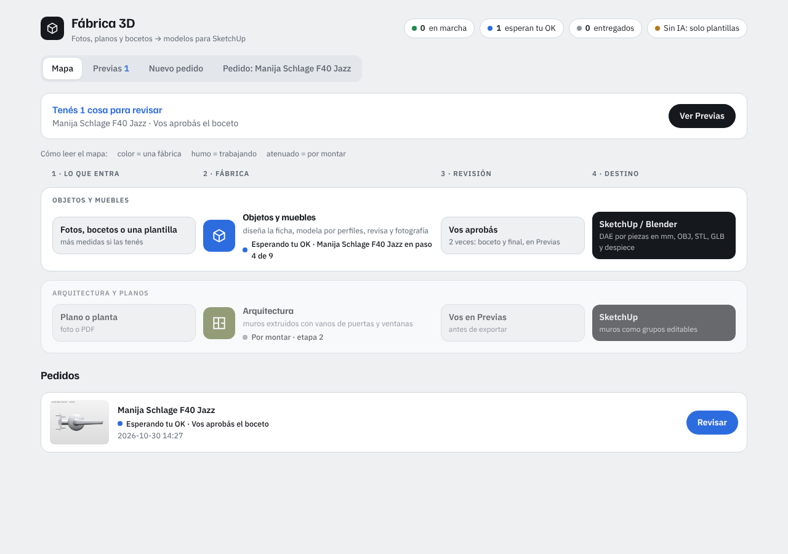
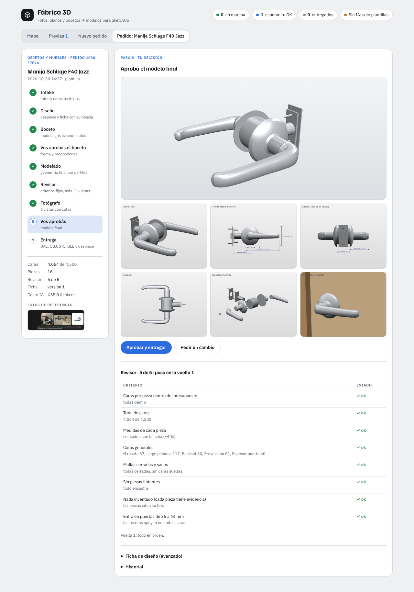

# Fábrica 3D

Subís fotos, bocetos o planos de un objeto y una línea de montaje te devuelve un modelo
liviano, separado por piezas y listo para importar en SketchUp (o Blender).



## Cómo correrla

```bash
python -m venv .venv
.venv\Scripts\activate          # Windows  (en Linux/Mac: source .venv/bin/activate)
pip install -r requirements.txt
copy .env.example .env          # y pegá tu ANTHROPIC_API_KEY
uvicorn app:app --reload
```

Abrí http://localhost:8000. Sin clave de IA funciona igual con las **plantillas** (por
ahora: manija Schlage F40 Jazz), así podés probar la línea completa sin gastar nada.

## Publicarla en internet (Render)

Netlify sirve solo páginas estáticas y la fábrica necesita Python corriendo, por eso va en
[Render](https://render.com) (plan gratis):

1. Subí esta carpeta a un repositorio de GitHub (sin `.env` ni `pedidos/`, ya están en `.gitignore`).
2. En Render: **New + → Blueprint** → elegí el repo. Lee `render.yaml` y arma el servicio.
3. Cuando te lo pida, completá `FABRICA_CLAVE` (la contraseña para entrar) y `ANTHROPIC_API_KEY`.
4. Queda en una URL tipo `https://fabrica3d.onrender.com`. El navegador pide usuario (cualquiera)
   y la contraseña.

Ojo con el plan gratis: el servicio se duerme tras 15 minutos sin uso (la primera visita tarda
unos 30 s) y el disco no es permanente, así que los pedidos se borran cuando se reinicia.
Descargá siempre los archivos de la entrega. Para que se guarden, en un plan pago agregá un
disco en `/opt/render/project/src/pedidos`.

## La línea de montaje

| # | Etapa | Qué hace |
|---|-------|----------|
| 1 | Intake | Guarda las fotos, medidas y notas. |
| 2 | Diseño | La IA mira las fotos y escribe una **ficha**: piezas, perfiles, caminos y medidas en mm. Cada pieza tiene que citar en qué foto se ve (nada inventado). No genera polígonos. |
| 3 | Boceto | El motor arma un modelo gris de baja resolución y el fotógrafo saca 3 vistas. |
| 4 | **Vos aprobás el boceto** | Aprobás o pedís un cambio en palabras. El cambio vuelve al diseño y, si tildás "recordar", queda en *Lo que la fábrica aprendió de vos* para los próximos pedidos. |
| 5 | Modelado | Geometría final por perfiles (sin subdivisiones). |
| 6 | Revisor | Criterios fijos, máximo 3 vueltas: caras por pieza y total, medidas, cotas, mallas cerradas, nada flotando, nada inventado, entra en el rango de espesor de puerta. Si sobran caras lo corrige solo; si hay otra falla, devuelve la ficha al diseñador. Con IA, además compara los renders contra tus fotos. |
| 7 | Fotógrafo | 6 vistas: isométrica, frente y lateral con cotas, superior, despiece e instalada en una puerta. |
| 8 | **Vos aprobás** | Revisás con el visor 3D, las vistas y la tabla del revisor. |
| 9 | Entrega | `modelo.dae` (cada pieza es un grupo con nombre, en mm, Z arriba), versión despiece, OBJ, STL, GLB y `despiece.csv`. |



## Por qué sale liviano y fiel

- **Modelado por perfiles, no mallas de IA.** Rosetas, cuellos, botones y tornillos se tornean
  desde un perfil 2D (como el Screw de Blender). La palanca es una sección redondeada que recorre
  una curva. Así la Jazz completa queda en 4.064 caras con 16 piezas.
- **Presupuesto de caras por pieza** escrito en la ficha y controlado por el revisor.
- **La IA describe, el motor construye.** Lo que escribe la IA es una ficha chica y editable
  (en la página del pedido: *Ficha de diseño (avanzado)*). Si algo no te cierra, lo tocás a mano.

## Estructura

```
app.py                     servidor web (FastAPI)
fabrica/geometria.py       motor: torno, barrido, caja, marco; variables del ensamble ("E/2+42")
fabrica/disenador.py       IA: fotos → ficha, y revisión visual
fabrica/revisor.py         criterios fijos + corrección automática de caras
fabrica/fotografo.py       renders por software (sin GPU) con cotas
fabrica/exportar.py        DAE por piezas, OBJ, STL, GLB, despiece CSV
fabrica/linea.py           etapas, puntos de aprobación, historial, costo de IA
fabrica/plantillas/        fichas aprobadas que sirven de ejemplo al diseñador
static/                    interfaz (Mapa, Previas, Nuevo pedido, Pedido)
pedidos/                   un directorio por pedido: fotos, fichas versionadas, renders, entrega
```

## Pendiente

- Línea de **Arquitectura y planos** (muros extruidos con vanos): está en el mapa como "por montar".
- El diseño desde fotos con IA está probado con respuestas simuladas, todavía no contra la API real.
- Más plantillas: cada pieza que apruebes se puede copiar a `fabrica/plantillas/` y pasa a ser
  ejemplo para el diseñador.
